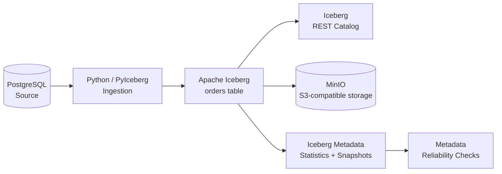

# Beyond Row Counts

### Using Apache Iceberg Metadata and Statistics for Reliable Data Pipelines

A reproducible local lab demonstrating how Apache Iceberg metadata can provide useful reliability signals that traditional pipeline checks — especially row counts alone — can miss.

The central idea is simple:

> **Everything can look healthy if you only look at row counts. It may not be.**

This project uses Apache Iceberg file-level statistics and snapshot metadata to detect controlled data corruption while the table's row count remains unchanged.

---

## The Problem

A common data-pipeline validation pattern looks something like this:

```text
Source rows = 10,000
Target rows = 10,000

PASS ✅
```

Row-count reconciliation is useful.

But it only answers:

> Did approximately the expected number of rows arrive?

It does **not** necessarily answer:

> Is the data itself still healthy?

For example, imagine that a pipeline accidentally changes:

```text
quantity
5 → 999

total_amount
2,499.00 → 999,999.99

state
VA → ZZ
```

The table can still contain exactly:

```text
10,000 rows
```

A row-count check therefore reports:

```text
PASS
```

while important characteristics of the data have changed.

Apache Iceberg already maintains useful metadata about table files and columns.

This lab explores how some of that metadata can become part of a lightweight pipeline reliability layer.

---

# Demo

The main demonstration intentionally corrupts data **without changing the number of rows**.

Run:

```bash
make demo
```

The result is approximately:

```text
Traditional Row-Count Check

Baseline     Current     Result
10,000       10,000      PASS
```

Everything appears healthy.

But Iceberg metadata tells a different story:

```text
Metadata Signal              Baseline       Current       Result

quantity upper bound                5            999       FAIL
total_amount upper bound      2499.00      999999.99       FAIL
state upper bound*                 VA             ZZ       FAIL
quantity null count                 0              0       PASS
total_amount null count             0              0       PASS
```

The takeaway:

```text
ROW COUNT: PASS

METADATA QUALITY GATE: FAIL

Same row count.
Different data quality.
```

`*` The state example uses Iceberg's recorded lexicographic upper bound as a simple demonstration signal. It is **not** equivalent to validating membership in an allowed state-code domain.

---

# Why Apache Iceberg Metadata?

Iceberg maintains metadata that query engines use for operations such as file pruning and table management.

Depending on the table's metrics configuration, useful signals can include:

- record counts
- null counts
- NaN counts
- lower bounds
- upper bounds
- file counts
- file sizes
- schema information
- snapshot history

Instead of treating that metadata only as internal table-format information, a pipeline can also use selected signals for inexpensive reliability checks.

Conceptually:

```text
                       ┌─────────────────────┐
                       │   Data Pipeline     │
                       └──────────┬──────────┘
                                  │
                                  ▼
                       ┌─────────────────────┐
                       │   Iceberg Table     │
                       └──────────┬──────────┘
                                  │
                 ┌────────────────┴────────────────┐
                 │                                 │
                 ▼                                 ▼
        Traditional Checks                 Iceberg Metadata
        ──────────────────                 ────────────────
        Row count                           Record count
        Freshness                           Null counts
                                             Lower bounds
                                             Upper bounds
                                             Snapshots
                 │                                 │
                 └────────────────┬────────────────┘
                                  ▼
                         Reliability Decision
```

The goal is **not** to replace existing data-quality systems.

The goal is to use metadata the table format already maintains as another source of evidence.

---

# Architecture

The lab runs entirely locally.



### Components

| Component | Purpose |
|---|---|
| PostgreSQL | Simulated operational source system |
| Python | Deterministic data generation and pipeline logic |
| PyIceberg | Iceberg table operations |
| Iceberg REST Catalog | Local Iceberg catalog |
| MinIO | S3-compatible object storage |
| Apache Iceberg | Table format and metadata layer |
| Docker Compose | Local infrastructure |
| pytest | Automated tests |
| Ruff | Linting and formatting |

The lab intentionally avoids requiring Spark, Kafka, Airflow, or a cloud account.

---

# Quick Start

## Requirements

You need:

- Docker
- Docker Compose
- Python 3.12
- [`uv`](https://docs.astral.sh/uv/)
- `make`

Clone the repository:

```bash
git clone https://github.com/jkasireddy/iceberg-reliability-lab.git
cd iceberg-reliability-lab
```

Install Python dependencies:

```bash
uv sync
```

Copy the local configuration:

```bash
cp .env.example .env
```

Start the infrastructure:

```bash
make up
```

Then run the main demonstration:

```bash
make demo
```

---

# Local Services

The Docker Compose environment runs:

| Service | Address |
|---|---|
| PostgreSQL | `localhost:5432` |
| Iceberg REST Catalog | `http://localhost:8181` |
| MinIO S3 API | `http://localhost:9000` |
| MinIO Console | `http://localhost:9001` |

Default local credentials are intentionally simple because this environment is for local development only.

They must not be reused in a real deployment.

---

# What `make demo` Does

The presentation demo performs four steps.

### 1. Create a healthy deterministic source

The generator creates:

```text
10,000 orders
```

using a fixed random seed so the experiment is reproducible.

Examples of healthy bounds include:

```text
quantity upper bound       = 5
total_amount upper bound   = 2499.00
state upper bound          = VA
```

### 2. Load the healthy Iceberg table

The data is written to:

```text
reliability.orders
```

and the healthy Iceberg metadata becomes the reference state.

### 3. Inject controlled corruption

The source is modified so that selected rows contain values such as:

```text
quantity = 999

total_amount = 999999.99

state = ZZ
```

No rows are added or removed.

The source still contains:

```text
10,000 rows
```

### 4. Compare traditional and metadata signals

Traditional reconciliation reports:

```text
10,000 == 10,000

PASS
```

Iceberg metadata reveals:

```text
quantity upper bound
5 → 999

total_amount upper bound
2499.00 → 999999.99

state upper bound
VA → ZZ
```

The metadata quality gate therefore fails.

---

# Metadata Signals Used

The lab builds a small profile from Iceberg's data-file metadata.

For selected columns it aggregates:

```text
value_count
null_count
nan_count
lower_bound
upper_bound
```

It also records:

```text
snapshot_id
file_count
record_count
file_size_in_bytes
```

For multiple Iceberg data files, table-level signals are calculated from file metadata.

Conceptually:

```text
File A
quantity lower = 1
quantity upper = 5

File B
quantity lower = 2
quantity upper = 999

               ↓

Observed metadata bounds

quantity lower = 1
quantity upper = 999
```

This allows some changes to be identified without performing a full analytical scan solely for the validation check.

---

# Quality Gate

The demonstration includes several intentionally simple metadata rules.

Examples:

```text
quantity upper bound
<= 5

total_amount upper bound
<= 2500.00

state recorded upper bound
<= VA

quantity null count
<= 0

total_amount null count
<= 0
```

These rules are designed to demonstrate the mechanism, not define a complete production data-quality framework.

The implementation separates:

```text
generic validation rules
        ↓
table-specific quality policy
        ↓
human-facing CLI
```

so the individual pieces can be tested independently.

---

# Additional Reliability Scenarios

The repository contains several supporting scenarios beyond the main corruption demo.

These are useful for exploring how table reliability interacts with incremental pipelines.

---

## 1. Incremental Processing

The lab implements watermark-based incremental extraction from PostgreSQL.

It uses the composite cursor:

```text
(updated_at, order_id)
```

rather than only:

```text
updated_at
```

This provides deterministic ordering when multiple rows share the same timestamp.

A generated change batch contains:

```text
200 updates
500 inserts
───────────
700 changes
```

Run:

```bash
make incremental-demo
```

Expected result:

```text
Batch rows       : 700

Rows updated     : 200
Rows inserted    : 500

PostgreSQL rows  : 10,500
Iceberg rows     : 10,500
```

The watermark advances only after the Iceberg write and validation succeed.

---

## 2. Crash, Replay, and Idempotency

A reliable pipeline should tolerate retries.

This lab can intentionally simulate a crash:

```text
extract changes
        ↓
write changes to Iceberg
        ↓
validate target
        ↓
CRASH
        ↓
watermark was not advanced
```

The next run therefore extracts the same batch again.

Because the sink operation uses the order identifier as the upsert key, replay becomes a no-op.

Run:

```bash
make demo-crash-replay
```

A successful replay looks approximately like:

```text
Replay batch rows : 700

Rows updated      : 0
Rows inserted     : 0

Snapshot before   : X
Snapshot after    : X
```

The unchanged snapshot demonstrates that the replay did not create another table change.

This is an example of using an **idempotent sink** to make retries safer.

---

## 3. Late-Arriving Data

Event time and change time describe different things.

Consider an order with:

```text
order_timestamp = August 7
updated_at      = August 15
```

The business event happened in the past, but the source system received or changed the record later.

A cursor based on:

```text
order_timestamp
```

can miss it.

A cursor based on:

```text
updated_at
```

can capture it.

The lab demonstrates:

```text
Event-time cursor would extract : 0

Change-time cursor will extract  : 1
```

This is why the incremental pipeline uses source change time rather than business event time as its high-watermark signal.

### Important limitation

This is still a **high-watermark incremental strategy**.

It is not log-based CDC.

If a record appears whose `updated_at` is itself older than the committed watermark, this strategy can still miss it.

Production systems commonly address this with approaches such as:

- log-based CDC
- overlapping/lookback extraction windows
- idempotent reprocessing
- reconciliation processes

---

# Watermark Lifecycle

An important design decision in the lab is that extraction does **not** advance the watermark.

Instead:

```text
Read watermark
      ↓
Extract source changes
      ↓
Save batch
      ↓
Apply batch to Iceberg
      ↓
Validate source vs target
      ↓
Advance watermark
```

If the process fails before the final step:

```text
watermark remains unchanged
```

and the same source changes can safely be retried.

This separates:

```text
"What did I read?"
```

from:

```text
"What did I successfully commit?"
```

---

# Why This Is Not Called CDC

The lab simulates change processing using:

```text
updated_at + order_id
```

watermarks.

It does **not** consume a database transaction log.

Therefore the project describes this mechanism as:

> **watermark-based incremental processing**

rather than claiming that it is true log-based Change Data Capture.

A production CDC architecture could use technologies such as Debezium, database-native replication, or cloud CDC services while keeping many of the same downstream reliability ideas.

---

# Project Structure

```text
iceberg-reliability-lab/
│
├── compose.yaml
├── Makefile
├── pyproject.toml
├── .env.example
│
├── artifacts/
│   └── local generated demo artifacts
│
├── docs/
│   └── architecture/
│
├── src/
│   │
│   ├── demo.py
│   │
│   ├── config.py
│   │
│   ├── generator/
│   │   └── deterministic PostgreSQL source generation
│   │
│   ├── iceberg_lab/
│   │   ├── catalog.py
│   │   ├── orders.py
│   │   ├── source.py
│   │   └── table_stats.py
│   │
│   ├── ingestion/
│   │   ├── initial_load.py
│   │   ├── watermark.py
│   │   ├── batch.py
│   │   ├── extract_incremental.py
│   │   └── apply_incremental.py
│   │
│   ├── scenarios/
│   │   ├── corrupt_values.py
│   │   ├── generate_changes.py
│   │   └── late_arrival.py
│   │
│   └── validation/
│       ├── metrics.py
│       ├── profile.py
│       ├── baseline.py
│       ├── rules.py
│       ├── quality_gate.py
│       ├── metadata_inspector.py
│       ├── capture_baseline.py
│       ├── compare_baseline.py
│       └── run_checks.py
│
└── tests/
    └── unit tests for pipeline and validation logic
```

---

# Running Tests

Run the fast automated test suite:

```bash
make test
```

The project currently exercises areas including:

```text
deterministic data generation
metadata aggregation
profile construction
baseline persistence
metadata comparison
validation rules
quality-gate behavior
incremental batch handling
Iceberg metadata row counts
```

Run Ruff:

```bash
uv run ruff check src tests
```

Format code:

```bash
uv run ruff format src tests
```

---

# Useful Commands

Start the environment:

```bash
make up
```

Stop it:

```bash
make down
```

Run the main presentation demo:

```bash
make demo
```

Run the developer-oriented corruption workflow:

```bash
make demo-corruption
```

Run incremental processing:

```bash
make incremental-demo
```

Run crash/replay:

```bash
make demo-crash-replay
```

Reset the deterministic baseline:

```bash
make reset
```

Run the quality gate:

```bash
make check
```

Inspect Iceberg metadata:

```bash
uv run python -m src.validation.metadata_inspector
```

---

# What Iceberg Metadata Can Tell Us

Metadata can be especially useful for identifying signals such as:

```text
unexpected upper/lower bounds
unexpected null-count changes
unexpected record-count changes
unexpected file-count growth
snapshot activity
some forms of schema change
```

These signals can often be evaluated substantially more cheaply than repeatedly scanning every row solely to calculate the same statistics.

---

# What Iceberg Metadata Cannot Tell Us

Iceberg metadata is **not a complete data-quality solution**.

For example, metadata bounds alone cannot reliably prove rules such as:

```sql
state IN ('MD', 'VA', 'DC')
```

They also cannot generally prove:

```text
primary-key uniqueness

referential integrity

cross-column business rules

semantic correctness

complex distributions

unexpected duplicate records

whether an individual row is logically valid
```

Those checks may require:

- table scans
- query-engine validation
- dedicated data-quality frameworks
- reconciliation against source systems
- application-level business rules

The intended architecture is therefore:

```text
                    Reliability Layer

             ┌──────────────┬───────────────┐
             │              │               │
             ▼              ▼               ▼
        Iceberg        Traditional      Deeper Data
        Metadata       Pipeline Checks  Quality Checks

        cheap           row counts       uniqueness
        signals         freshness        business rules
        snapshots       reconciliation   semantic checks

             └──────────────┬───────────────┘
                            ▼

                    Better confidence
```

Metadata complements those systems rather than replacing them.

---

# A Note About Metadata Bounds

Iceberg column statistics are maintained at the file level according to the table's metrics configuration.

Recorded bounds should therefore be treated as:

> **metadata statistics maintained by Iceberg**

rather than blindly assumed to be identical to the result of:

```sql
SELECT MIN(column), MAX(column)
```

for every possible Iceberg metrics configuration and data type.

For some values, particularly strings, metadata may be truncated according to the configured metrics mode.

This lab intentionally uses values where the resulting metadata changes are clear and easy to demonstrate.

---

# Design Goals

This repository intentionally prioritizes:

### Reproducibility

The generator uses deterministic seeds so the same scenarios can be recreated.

### Small infrastructure footprint

The entire environment runs locally with Docker Compose.

### Vendor neutrality

The core reliability idea does not require a specific cloud provider or commercial data-quality platform.

### Failure-oriented examples

The lab intentionally creates:

- silent value corruption
- incremental changes
- replay after failure
- late-arriving records

because reliability patterns become easier to understand when systems fail in controlled ways.

### Clear boundaries

The project deliberately distinguishes:

```text
metadata signals
```

from:

```text
full data-quality validation
```

and:

```text
watermark-based incremental processing
```

from:

```text
log-based CDC
```

---

# Production Considerations

This repository is a **production-style educational lab**, not a production platform.

A real deployment would likely require additional concerns such as:

```text
authentication and authorization

secret management

catalog high availability

distributed processing

observability

metrics and alerting

schema governance

partition strategy

Iceberg maintenance

snapshot expiration

orphan-file cleanup

compaction

retry policies

dead-letter handling

CDC infrastructure

data contracts

SLA/SLO definitions
```

Those topics are intentionally outside the scope of this demonstration.

---

# Main Takeaway

Row counts remain useful.

But they are only one signal.

Apache Iceberg tables already maintain metadata that can help answer additional questions about the health of a pipeline.

The important pattern is:

```text
Do not ask only:

"Did the expected number of rows arrive?"


Also ask:

"What does the metadata tell us
about the data that arrived?"
```

Or, in the example demonstrated by this project:

```text
10,000 rows → 10,000 rows

Row-count check:
PASS ✅


But...

quantity      5 → 999
total_amount  2499.00 → 999999.99
state         VA → ZZ

Metadata quality gate:
FAIL ❌
```

> **Same row count. Different data quality.**

---

# About This Project

This repository accompanies the technical presentation:

**Beyond Row Counts: Using Apache Iceberg Metadata and Statistics for Reliable Data Pipelines**

The project is intended as a small, reproducible example for engineers interested in Apache Iceberg, incremental data pipelines, metadata-driven validation, and data reliability.

It is designed to make one idea concrete:

> **The metadata your table format already maintains can become part of your reliability system.**